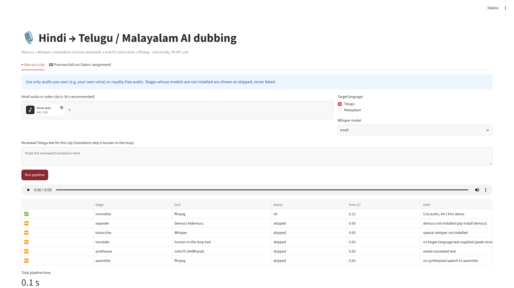
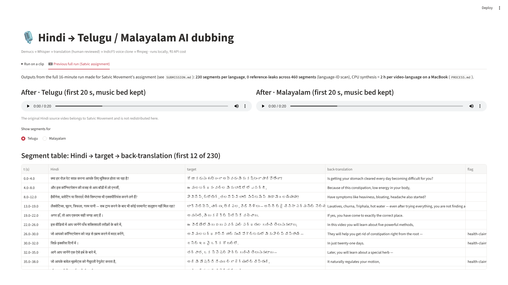

<div align="center">

[](https://github.com/gitswagata1/satvic-ai-dubbing)

**Dub Hindi audio into Telugu and Malayalam in the creator's cloned voice — fully open-source, zero API cost.**

### ▶ [Live demo: listen to the dubs, see the pipeline and QC](https://gitswagata1.github.io/satvic-ai-dubbing/)

<br/>

[](LICENSE)
[](https://github.com/gitswagata1/satvic-ai-dubbing/stargazers)
[](https://github.com/gitswagata1/satvic-ai-dubbing/network/members)
[](https://github.com/gitswagata1/satvic-ai-dubbing/issues)
[](CONTRIBUTING.md)
[](https://python.org)

</div>


> **Problem:** Indian creators' long-form content stays locked in one language, and commercial dubbing is expensive and rarely supports Telugu or Malayalam in the speaker's own voice.
> **Solution:** a local chain of open models (Demucs → Whisper → human-reviewed translation → IndicF5 voice clone → ffmpeg) that dubs Hindi into Telugu and Malayalam at ₹0 API cost.
>
> **Key features:** ① 5-model pipeline with per-stage status and timing (`pipeline.py`, `timings.json`) · ② Streamlit UI: upload a clip → choose language → watch each stage → play output · ③ Automated QC: a cleaner voice reference plus a scan-and-regenerate loop brought reference-echo leaks to **0 of 460 segments** (final content-based scan)
>
> **Tech stack:** Python · PyTorch · Demucs · OpenAI Whisper · IndicF5 (AI4Bharat) · ffmpeg · Streamlit
>
> **Status: prototype.** It has been used once end to end, on a 16-minute video for Satvic Movement's assignment.
>
> **How this maps to battery-lifespan prediction:** it is a chain of ML models with measured stages, QC gates and a human in the loop, the same engineering a simulation → ML-surrogate → dashboard pipeline needs (for example MD runs → feature extraction → degradation model → RUL dashboard).

---

## What is this?

An end-to-end AI dubbing pipeline that takes Hindi video/audio and produces dubbed versions in **Telugu** and **Malayalam** — using the original speaker's cloned voice. Every component is open-source:

| Step | Model / Tool | What it does |
|------|-------------|-------------|
| **Voice separation** | [Demucs](https://github.com/facebookresearch/demucs) | Separates vocals from background music/noise |
| **Transcription** | [OpenAI Whisper](https://github.com/openai/whisper) | Transcribes Hindi speech to text |
| **Translation** | Translation pipeline | Hindi text to Telugu / Malayalam |
| **Voice synthesis** | [IndicF5 TTS](https://github.com/ai4bharat/IndicF5) | Clones the speaker's voice in the target language |
| **Assembly** | [ffmpeg](https://ffmpeg.org/) | Merges dubbed audio back with original background |

**Total API cost: Rs. 0** — everything runs locally. The original run used a MacBook CPU; synthesis took about 2 h per video-language (see `2_Process_and_Reasoning/PROCESS.md`). A GPU cuts this to minutes.

---

## Pipeline Architecture

```
Input Audio/Video
       |
       v
+----------------+
|    Demucs      |---- Background track (preserved)
|   Separation   |
+-------+--------+
        | Vocals only
        v
+----------------+
|    Whisper     |
|  Transcription |
+-------+--------+
        | Hindi text
        v
+----------------+
|  Translation   |
|  Hindi -> TG   |
|  Hindi -> ML   |
+-------+--------+
        | Target language text
        v
+----------------+
|  IndicF5 TTS   |---- Voice cloning from original speaker
|   Synthesis    |
+-------+--------+
        | Dubbed audio
        v
+----------------+
|    ffmpeg      |<--- Background track (from Demucs)
|   Assembly     |
+----------------+
        |
        v
  Final Dubbed Video
```

---

## Project Structure

```
satvic-ai-dubbing/
├── 1_Final_Videos/              # Output dubbed videos
├── 2_Process_and_Reasoning/     # Documentation of the dubbing process
├── 3_Accuracy_Review_Kit/       # QC sheets and reviewer instructions
├── 4_Audio_Samples/             # 20 s Telugu / Malayalam outputs from the authorised run
├── 5_Pipeline_Workspace/        # Main pipeline code
│   ├── app.py                   # Streamlit UI: upload → stages + timing → play output
│   ├── pipeline.py              # Clip-level pipeline, per-stage timing table + timings.json
│   ├── scripts/                 # Core pipeline scripts
│   │   ├── synth_full.py        # Full synthesis pipeline
│   │   ├── assemble.py          # Audio assembly
│   │   ├── detect_report.py     # Detection and reporting
│   │   ├── fix_leaks.py         # Audio leak fixing
│   │   └── ...
│   ├── requirements.txt         # Python dependencies
│   └── data/                    # Input data
├── demo/                        # How to make an own-voice before/after clip
├── docs/screenshots/            # UI screenshots
├── Pitch_Deck.pdf               # Project pitch deck
├── SUBMISSION.md                # Detailed submission document
├── Dockerfile                   # Placeholder (does not run the pipeline yet)
├── Makefile                     # Dev commands
└── LICENSE                      # MIT
```

---

## Screenshots

| Pipeline stages + timing | Before/after + segment table |
|---|---|
|  |  |

---

## Quickstart

### Hardware used

| | |
|---|---|
| Original 16-min run | MacBook, CPU only (no GPU). IndicF5 synthesis ≈ 2 h per language |
| Recommended | Any CUDA GPU with 8 GB+ VRAM for fast synthesis; CPU works but is slow |

### Models and licences

| Stage | Model / tool | Licence |
|---|---|---|
| Separation | Demucs (Meta) | MIT |
| Transcription | Whisper (OpenAI) | MIT |
| Voice clone | IndicF5 (AI4Bharat), gated on Hugging Face | See model card; requires explicit permission from the voice owner |
| Assembly | ffmpeg | LGPL/GPL |

### Install

```bash
git clone https://github.com/gitswagata1/satvic-ai-dubbing.git
cd satvic-ai-dubbing/5_Pipeline_Workspace
python -m venv .venv && source .venv/bin/activate
pip install -r requirements.txt streamlit     # needs ffmpeg on PATH and a Hugging Face token for ai4bharat/IndicF5
```

### Run on a short clip (UI)

```bash
streamlit run app.py        # upload a clip, pick Telugu/Malayalam, see each stage + timing, play the output
```

### Run on a short clip (CLI, prints a per-stage timing table)

```bash
python pipeline.py ../demo/input_hi.wav --lang te --translation ../demo/translation_te.txt --out ../demo/output_te
```

```
stage       tool                     status   time (s)  note
normalize   ffmpeg                   ok           ...   ...
separate    Demucs htdemucs          ok           ...
transcribe  Whisper                  ok           ...
translate   human-in-the-loop text   ok           ...
synthesize  IndicF5 (AI4Bharat)      ok           ...
assemble    ffmpeg                   ok           ...
```

If a model isn't installed, its stage is reported as `skipped` with the reason. Results are never faked.

### Full-length scripts (as used for the Satvic run)

`5_Pipeline_Workspace/README.md` lists the exact order: `synth_full.py <te|ml>` → `fix_leaks.py <lang> scan` → `final_scan.py <lang>` → `assemble.py <lang>`. All scripts take the language as a positional argument and run from `5_Pipeline_Workspace/`.

> The `Dockerfile` is a placeholder and does not run the pipeline yet.

---

## Supported Languages

| Source | Target | Status |
|--------|--------|--------|
| Hindi | Telugu | Production |
| Hindi | Malayalam | Production |
| Hindi | Tamil | Planned |
| Hindi | Kannada | Planned |

---

## Quality Assurance

The `3_Accuracy_Review_Kit/` directory contains:
- **Reviewer instructions** for linguistic accuracy checks
- **Review sheets** (CSV) for Telugu and Malayalam output scoring
- **Glossary** of domain-specific terms

---

## Roadmap

- [ ] **Tamil language support** — extend pipeline to Tamil TTS
- [ ] **Batch processing** — dub multiple files in one run
- [ ] **Progress bar** — visual feedback for long dubbing jobs
- [ ] **Web UI** — Gradio/Streamlit interface for non-technical users
- [ ] **Lip sync** — basic visual alignment for video dubbing

See the [open issues](https://github.com/gitswagata1/satvic-ai-dubbing/issues) for community-requested features.

---

## Contributing

Contributions are welcome! See [CONTRIBUTING.md](CONTRIBUTING.md) for guidelines.

1. Fork the repo
2. Create a feature branch (`git checkout -b feature/my-feature`)
3. Commit your changes
4. Push and open a Pull Request

---

## Roadmap, contributing and citation

- **Roadmap:** [ROADMAP.md](ROADMAP.md) lists planned work and directions for the project.
- **Contributing:** see [CONTRIBUTING.md](CONTRIBUTING.md) and the
  [Code of Conduct](CODE_OF_CONDUCT.md). Issues labelled `good first issue` are a friendly start.
- **Citation:** [CITATION.cff](CITATION.cff) powers GitHub's "Cite this repository" button.

## License

Distributed under the MIT License. See [LICENSE](LICENSE) for details.

---

## Acknowledgments

- [Demucs](https://github.com/facebookresearch/demucs) by Meta Research — audio source separation
- [OpenAI Whisper](https://github.com/openai/whisper) — speech recognition
- [IndicF5](https://github.com/ai4bharat/IndicF5) by AI4Bharat — Indic language TTS
- [ffmpeg](https://ffmpeg.org/) — multimedia processing

---

<div align="center">

**Built by [Swagata Banerjee](https://github.com/gitswagata1)**

*Zero-cost AI dubbing for Indian languages.*

[](https://github.com/gitswagata1/satvic-ai-dubbing)

</div>
